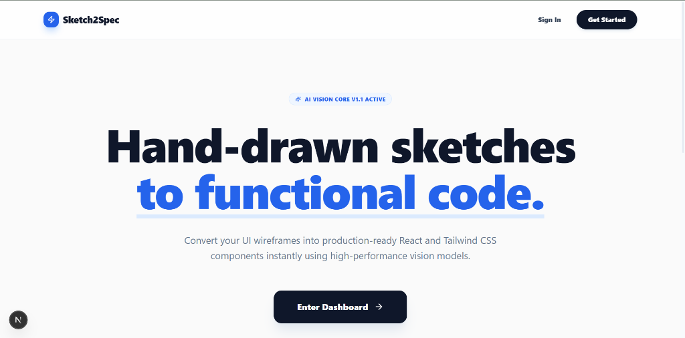

# Sketch2Spec

Sketch2Spec is an AI-powered design-to-code assistant that turns hand-drawn wireframes and UI screenshots into working React + Tailwind components. Upload an image, and a Gemini vision model generates the component; you can then edit it in a code editor, preview it live across device sizes, save it to your project history and copy the code.

**Live demo:** [sketch2spec.vercel.app](https://sketch2spec.vercel.app/)



## Results

- **~80% layout accuracy** on generated components
- **~2x faster prototyping** and **~60% less manual frontend effort** compared with hand-coding the same layouts

## Problem We Aim to Solve

The design-to-development handoff is slow and inefficient. Developers manually translate mockups into code, guess at spacing and colors, write repetitive component structures, and hope the result matches the design. Sketch2Spec gives you a working starting point instead: convert any wireframe or UI screenshot into React code, preview it across devices, and iterate quickly.

## Installation

### Prerequisites
- Node.js 20.x or higher
- npm
- Accounts / keys for:
  - [Google Gemini API](https://aistudio.google.com/app/apikey)
  - A Google OAuth client (for sign-in via NextAuth)
  - [Supabase](https://supabase.com/) (Postgres, for saved projects)
  - [Cloudinary](https://cloudinary.com/) (image uploads)

### Setup Instructions

1. **Clone the repository**
   ```bash
   git clone https://github.com/Kaushal-Loya/Sketch2Spec.git
   cd Sketch2Spec
   ```

2. **Install dependencies** (npm workspaces: `frontend`, `backend`)
   ```bash
   npm install
   ```

3. **Configure environment variables**

   Create `frontend/.env.local`:
   ```env
   # Auth (NextAuth + Google)
   GOOGLE_CLIENT_ID=...
   GOOGLE_CLIENT_SECRET=...
   NEXTAUTH_SECRET=...
   # NEXTAUTH_URL=https://your-domain   (production only)

   # Google Gemini AI
   GEMINI_API_KEY=AIza...
   GEMINI_MODEL=gemini-1.5-flash

   # Supabase
   NEXT_PUBLIC_SUPABASE_URL=https://xxxx.supabase.co
   NEXT_PUBLIC_SUPABASE_ANON_KEY=...
   SUPABASE_SERVICE_ROLE_KEY=...

   # Cloudinary
   CLOUDINARY_CLOUD_NAME=your_cloud_name
   CLOUDINARY_API_KEY=your_api_key
   CLOUDINARY_API_SECRET=your_api_secret

   # Optional: protects /api/admin/provider-logs
   ADMIN_API_KEY=...
   ```

4. **Start the development server**
   ```bash
   npm run dev
   ```

5. **Open your browser**

   Navigate to [http://localhost:3000](http://localhost:3000)

## Tech Stack

| Tech | Purpose |
|------|---------|
| Next.js 16 (App Router) & Tailwind CSS | Frontend framework and styling |
| React 19 | UI library |
| TypeScript | Type safety and developer experience |
| NextAuth (Google provider) | Authentication with JWT sessions |
| Supabase (Postgres) | Per-user project history |
| Google Gemini | Vision AI for wireframe-to-code generation |
| Cloudinary | Signed image uploads and storage |
| CodeMirror | In-browser code editor with linting |
| Babel Standalone | Browser-based JSX transformation for the preview |
| Framer Motion, Lucide React | Animation and icons |

## Key Features

### AI-Powered Code Generation

Sketch2Spec sends your wireframe to a Google Gemini vision model (configured with `GEMINI_MODEL`) and generates a complete React component styled with Tailwind CSS. The model extracts layout hierarchy, identifies UI elements and produces clean JSX ready to use in your projects.

### Smart Code Sanitization & Validation

Generated code is checked and cleaned before it is shown:

- Removes TypeScript syntax and markdown fences for browser compatibility
- Converts ES module imports to UMD globals for iframe rendering
- Auto-detects Lucide React icons used in the JSX (with a placeholder fallback for unknown icons)
- Validates completeness: balanced braces, JSX tags, component structure and exports
- Retries failed generations with exponential backoff and jitter

### Code Editor & Live Preview

- **CodeMirror editor** with JSX syntax highlighting, bracket matching and a built-in syntax linter
- **Sandboxed iframe preview** that updates as you edit
- **Responsive device switching**: desktop (100%), tablet (768px) and mobile (375px)
- **Clear error states** for compile errors, render errors and missing components
- **One-click copy** of the full component code
- **Regenerate** a draft from the same image without re-uploading
- **Unsaved-changes protection** when leaving the editor

### Project History

- Sign in with Google, then save generated components as named projects
- Rename, reopen, reset to the original output, or delete projects from the History page
- Every data route checks that the project belongs to the signed-in user

### Secure Image Management

- Uploads go directly to Cloudinary using server-signed upload parameters
- Supports PNG, JPG, JPEG and WebP images

## Project Structure

```
Sketch2Spec/
├── package.json                  # npm workspaces: frontend, backend
├── scripts/dryRun.ts             # smoke test for API routes
├── backend/                      # placeholder workspace
└── frontend/
    ├── app/
    │   ├── api/
    │   │   ├── ai/generate/route.ts           # AI code generation
    │   │   ├── auth/[...nextauth]/route.ts    # NextAuth (Google)
    │   │   ├── auth/delete-account/route.ts   # delete a user's saved data
    │   │   ├── cloudinary/sign/route.ts       # Cloudinary upload signature
    │   │   ├── history/route.ts               # list / create projects
    │   │   ├── history/[id]/route.ts          # get / update / delete a project
    │   │   └── admin/provider-logs/route.ts   # recent AI request logs
    │   ├── dashboard/            # upload & generate
    │   ├── preview/              # editor + live preview
    │   ├── history/              # saved projects
    │   ├── profile/              # account page
    │   ├── sign-in/, sign-up/    # Google sign-in
    │   ├── layout.tsx
    │   └── page.tsx              # landing page
    ├── components/               # app shell, sidebar, navbar, UI
    ├── lib/
    │   ├── aiProviders.ts        # Gemini call, prompt, sanitizers, retry
    │   ├── buildPreviewSrcDoc.ts # preview iframe builder
    │   ├── auth.ts               # NextAuth options
    │   ├── supabase.ts           # server-side Supabase client
    │   └── aiLogger.ts           # request logging
    └── assets/
```

## Usage

1. **Sign in with Google**
2. **Open the Dashboard** and upload your wireframe or screenshot
3. **Click "Generate"** and wait a few seconds
4. **Open the editor** to view the code and live preview, and switch device sizes
5. **Name and save** the project, then edit, copy or regenerate as needed
6. **Revisit saved projects** from the History page

### Tips for Best Results

- Use high-contrast, well-lit photos of your sketches
- Start with simpler layouts for better accuracy
- Add labels or annotations to wireframes for context
- Regenerate to explore different interpretations

## API Endpoints

All routes except NextAuth require a signed-in session.

### `POST /api/ai/generate`

Generate React code from a wireframe image URL.

**Request:**
```json
{
  "imageUrl": "https://res.cloudinary.com/..."
}
```

**Response:**
```json
{
  "code": "const React = window.React; ...",
  "provider": "Gemini",
  "fallbackUsed": false
}
```

### `POST /api/cloudinary/sign`

Returns signed upload parameters for a direct Cloudinary upload.

**Response:**
```json
{
  "signature": "...",
  "timestamp": 1234567890,
  "api_key": "...",
  "cloud_name": "..."
}
```

### Project history

- `GET /api/history` – list your saved projects
- `POST /api/history` – save a project
- `GET | PATCH | DELETE /api/history/[id]` – read, rename/update, or delete a project

## Configuration

### AI Model Settings

Adjust generation parameters in `frontend/lib/aiProviders.ts`:

```typescript
generationConfig: {
  temperature: 0.2,        // Lower = more deterministic
  maxOutputTokens: 16000,  // Maximum code length
  topP: 0.95,
  topK: 40,
}
```

### Preview Customization

Modify the preview environment in `frontend/lib/buildPreviewSrcDoc.ts`:

- React UMD: `react@18`
- Tailwind CDN: `cdn.tailwindcss.com`
- Lucide icons: `lucide-react@0.474.0`
- Babel: `@babel/standalone@7.23.5`

## Development

### Available Scripts

Run from the repository root:

```bash
npm run dev            # start development server
npm run build          # build for production
npm run start          # start production server
npm run lint           # lint code
npm run test:backend   # API smoke test
```

## Deployment

### Deploy to Vercel

1. Import the repository in [Vercel](https://vercel.com) with `frontend` as the root directory
2. Add all environment variables from `frontend/.env.local`, plus `NEXTAUTH_URL` set to your production URL
3. Add `https://your-domain/api/auth/callback/google` as an authorized redirect URI in your Google OAuth client
4. Deploy

## Troubleshooting

**Preview not rendering**
- Check the browser console for errors
- Verify `window.__PREVIEW_COMPONENT__` is defined
- Ensure the Babel transformation completed successfully

**API rate limits**
- Gemini has rate limits; add delays between requests
- Check your quota in Google AI Studio / Google Cloud Console

**Image upload fails**
- Verify Cloudinary credentials are correct
- Check image size (max 10MB recommended)

**Sign-in fails**
- Check `GOOGLE_CLIENT_ID`, `GOOGLE_CLIENT_SECRET` and `NEXTAUTH_SECRET`
- Make sure the OAuth redirect URI matches your domain

## Contributing

Contributions are welcome! Please follow these steps:

1. Fork the repository
2. Create a feature branch (`git checkout -b feature/amazing-feature`)
3. Commit your changes (`git commit -m 'Add amazing feature'`)
4. Push to the branch (`git push origin feature/amazing-feature`)
5. Open a Pull Request

## Roadmap

- [ ] Support for Claude and GPT-4 Vision models
- [ ] Export to CodeSandbox and StackBlitz
- [ ] Component library integration (Material-UI, Chakra UI)
- [ ] Version history for generated code
- [ ] Collaborative editing and sharing
- [ ] Figma plugin integration
- [ ] Drag-and-drop and batch processing for multiple wireframes

## Acknowledgments

- **Google Gemini** for vision AI capabilities
- **NextAuth** and **Supabase** for authentication and data
- **Cloudinary** for image hosting
- **Vercel** for deployment
- **shadcn/ui** for UI components

---

**Built by [Kaushal Loya](https://github.com/Kaushal-Loya)** · [LinkedIn](https://www.linkedin.com/in/kaushal-loya) · [Portfolio](https://kaushalloya.in)

*Transform your sketches into reality, one component at a time.*
